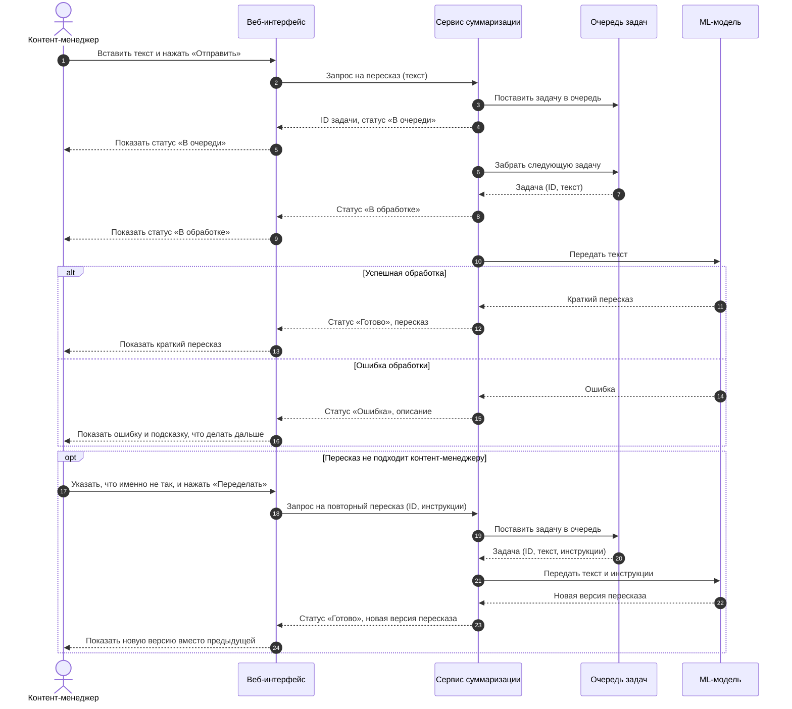
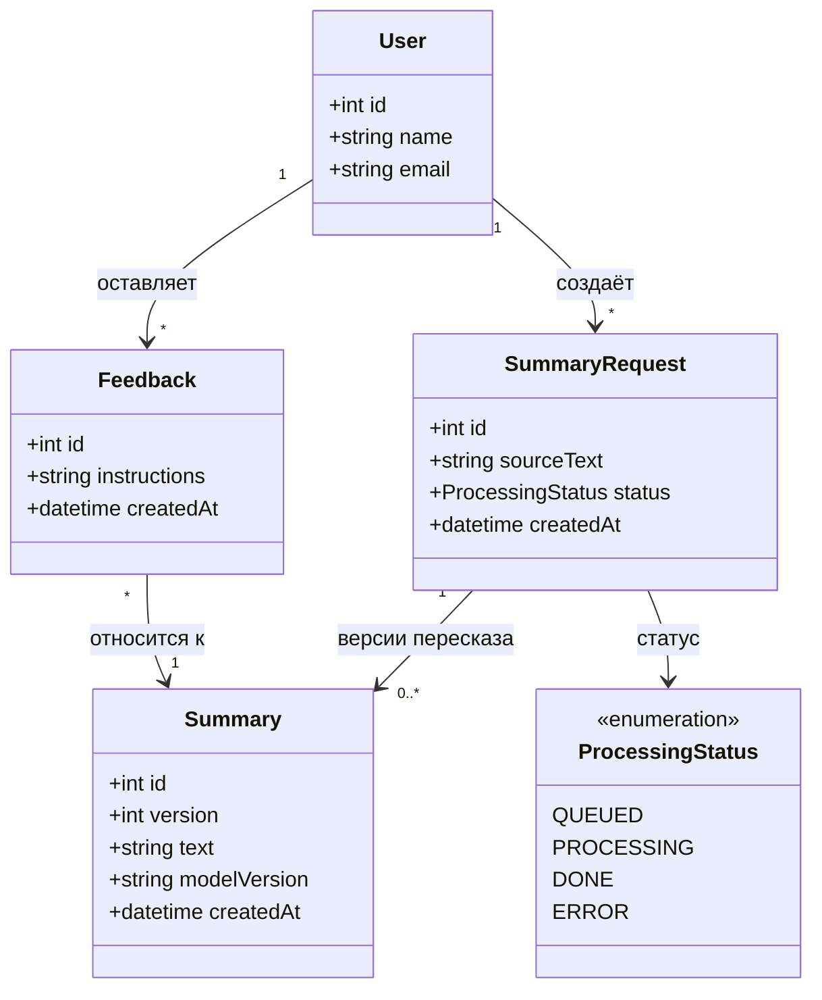

# Диаграммы

## Диаграмма последовательности

Диаграмма показывает сценарий UC-01 «Автоматический краткий пересказ»:
контент-менеджер отправляет текст, запрос проходит через очередь задач,
ML-модель выполняет суммаризацию, а контент-менеджер видит статус обработки и результат.

## Диаграмма классов

Диаграмма описывает основные сущности сервиса. Каждый повторный пересказ
сохраняется как новая версия результата, поэтому у запроса может быть несколько
пересказов. Контент-менеджер видит последний из них, а предыдущие остаются в системе.

