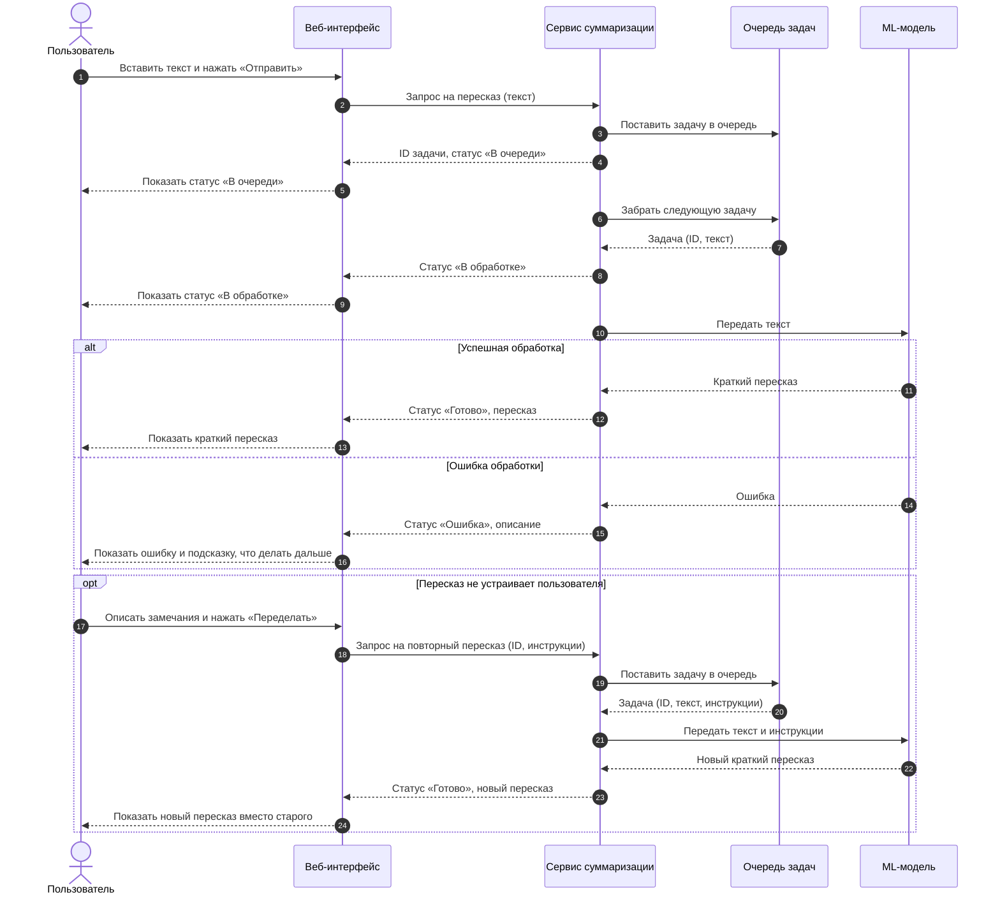
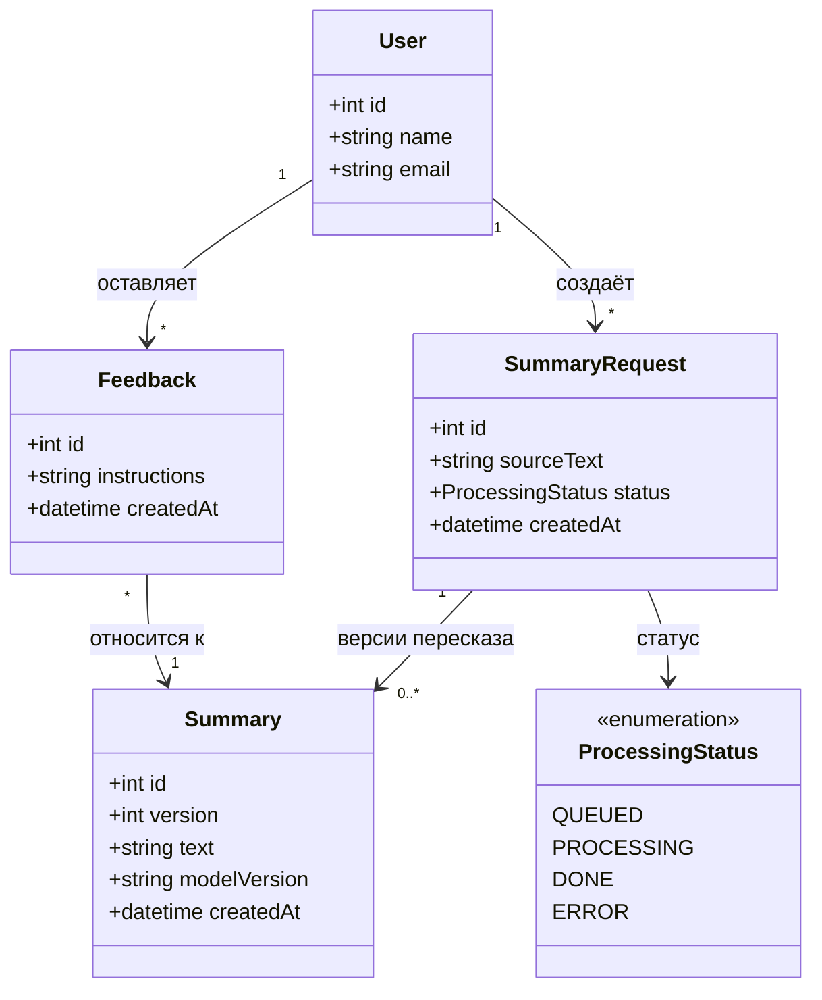

# Диаграммы

## Диаграмма последовательности

Диаграмма показывает сценарий UC-01 «Автоматический краткий пересказ»:
пользователь отправляет текст, запрос проходит через очередь задач,
ML-модель выполняет суммаризацию, а пользователь видит статус обработки и результат.

## Диаграмма классов

Диаграмма описывает основные сущности сервиса. Каждый повторный пересказ
сохраняется как новая версия результата, поэтому у запроса может быть несколько
пересказов, а пользователь видит последний из них.

